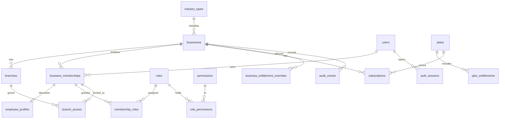

# Foundation Data Model (APPLIED: V0002–V0007)

Scope: businesses, industry types, branches, users, employee profiles, business memberships, roles, permissions, role permissions, branch access, auth sessions, subscription foundations, audit foundations. One addition not in the original list: `membership_roles` (needed to assign roles at all).

All tables: `id uuid PK DEFAULT gen_random_uuid()`, `created_at`, `updated_at timestamptz`, `created_by`, `updated_by uuid`, `version bigint` (optimistic lock) unless stated. Money and ledgers do not appear in this phase.

## ER overview

## Global (not tenant-owned, no RLS; written only by platform admin / migrations)
| Table | Key columns and rules |
|---|---|
| `industry_types` | `code` unique (`restaurant, hotel, salon, retail, cafe, gym, clinic`), `name`, `is_active`. Seeded by migration. |
| `permissions` | `code` unique (`domain.resource.action`), `module`, `description`, `is_restricted bool` (true for clinic data). Seeded and versioned by migrations. |
| `plans` | `code` unique, `name`, `is_active`, `billing_interval`. |
| `plan_entitlements` | `plan_id` FK, `feature_key`, `limit_value int NULL` (NULL = unlimited), unique `(plan_id, feature_key)`. |
| `users` | One identity per person across businesses. `email citext` unique, `password_hash`, `status` (`pending, active, locked, disabled`), `email_verified_at`, `failed_login_count`, `locked_until`, `last_login_at`, `full_name`. |

## Tenant-owned (all have `business_id NOT NULL`, RLS enabled and forced)
| Table | Key columns and rules |
|---|---|
| `businesses` | `slug` unique, `legal_name`, `display_name`, `industry_type_id` FK, `country_code`, `default_currency`, `timezone`, `status` (`pending, active, suspended, closed`). Here `id` is the tenant id. Industry is immutable (trigger blocks UPDATE of `industry_type_id`). |
| `branches` | `business_id` FK, `code`, `name`, address fields, `timezone`, `status`, `is_head_office`. Unique `(business_id, code)` and `(business_id, id)` (target for composite FKs). One head office per business (partial unique index). |
| `business_memberships` | `business_id`, `user_id`, `status` (`invited, active, suspended, removed`), `all_branches bool`, invitation fields (`invited_by`, `invitation_token_hash`, `invitation_expires_at`, `accepted_at`). Unique `(business_id, user_id)` and `(business_id, id)`. |
| `employee_profiles` | `business_id`, `membership_id` (unique, 1:1), `employee_code`, `first_name`, `last_name`, `phone`, `job_title`, `hire_date`, `termination_date`. Composite FK `(business_id, membership_id)`. Unique `(business_id, employee_code)`. |
| `roles` | `business_id NULL` = system template (read-only to tenants), else a custom role of that business. `code`, `name`, `is_system`. Unique `(business_id, code)`. Custom roles may be cloned from system templates. |
| `role_permissions` | `role_id`, `permission_id`, `business_id NULL` (mirrors the role). PK `(role_id, permission_id)`. Restricted permissions (`is_restricted`) must only be attached to roles of a business whose industry supports them: NOT enforced in the DB yet, to be enforced in the application. |
| `membership_roles` | `business_id`, `membership_id`, `role_id`. PK `(membership_id, role_id)`. Composite FKs to memberships; the role must be a system template or the same business. |
| `branch_access` | `business_id`, `membership_id`, `branch_id`. PK `(membership_id, branch_id)`. Composite FKs `(business_id, membership_id)` and `(business_id, branch_id)` make cross-tenant links impossible. Ignored when the membership has `all_branches = true`. |
| `subscriptions` | `business_id`, `plan_id`, `status` (`trialing, active, past_due, cancelled, expired`), `current_period_start/end`, `trial_ends_at`, `cancel_at`. Partial unique index: one non-ended subscription per business. |
| `business_entitlement_overrides` | `business_id`, `feature_key`, `limit_value`, `reason`, `expires_at`. Effective entitlement = override if present, else plan value. |
| `auth_sessions` | `user_id`, `active_business_id`, `refresh_token_hash` (unique, never the raw token), `rotated_from_id`, `expires_at`, `revoked_at`, `ip`, `user_agent`, `last_used_at`. |
| `audit_events` | Append-only. `business_id NULL` for platform events, `branch_id`, `actor_user_id`, `action`, `entity_type`, `entity_id`, `occurred_at`, `trace_id`, `ip`, `metadata jsonb` (small context only; the facts are in typed columns). No `updated_*` or `version`. UPDATE and DELETE revoked from `misva_app` and blocked by trigger. Partition by month when volume requires it. |

## Tenant isolation design
- Policy on tenant tables: `business_id = current_setting('app.business_id', true)::uuid`. `roles` and `role_permissions` also allow `business_id IS NULL` for reads.
- The backend sets `app.business_id` and `app.user_id` with `SET LOCAL` at the start of every transaction, taken from the authenticated principal only. With `SET LOCAL` the values disappear at commit or rollback, so pooled connections cannot leak context. A request with no context sees zero rows.
- RLS is `ENABLE`d, not `FORCE`d: `misva_owner` (migrations only, never used at runtime) bypasses it, while `misva_app` has no `BYPASSRLS` and is always subject to it. Isolation tests run as `misva_app`.
- Pre-tenant flows (login, accept-invitation, list my businesses) read `users`, `business_memberships` and `auth_sessions` by `user_id`. Memberships and sessions get a second policy allowing `user_id = current_setting('app.user_id')`, so these flows never run without RLS.
- `users` has no `business_id`. It is protected by the application layer: column-level restriction is NOT implemented; password hashes must only be selected in the login use case (to revisit).

## Indexing
FK columns on every tenant table prefixed with `business_id`; `business_memberships(user_id)`; `auth_sessions(user_id) WHERE revoked_at IS NULL`; `audit_events(business_id, occurred_at DESC)`; `audit_events(entity_type, entity_id)`.

## Deliberately excluded
No customer, catalogue, billing or industry tables. No soft delete here: memberships use `status`, and branches and businesses use `status` too. Hard deletes are blocked by FK `RESTRICT` once rows are referenced.

## Decisions I need from you
1. **One global `users` identity, many memberships** (my recommendation: one login can work in several businesses) versus users owned by a single business.
2. **Many roles per membership** (via `membership_roles`) versus exactly one.
3. **Roles apply business-wide, `branch_access` limits where** (my recommendation), versus per-branch role assignment.
4. **Billing-gateway fields** (`provider_customer_id` etc.) stay out of `subscriptions` until the payment engine.

## Planned migrations (not yet written)
`V0002` industry types, plans, permissions and users; `V0003` businesses, branches, subscriptions; `V0004` memberships, employees, roles and access; `V0005` auth sessions and audit; `V0006` RLS policies and grants; `V0007` seed system roles and permissions.
